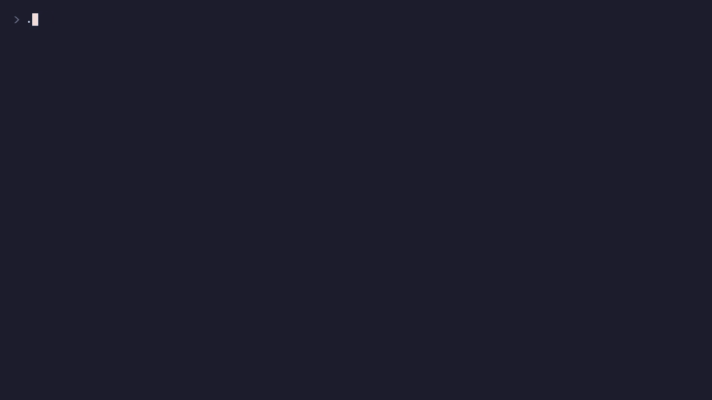

# sbom-triage-agent

SBOM 기반 공급망 위험 트리아지 에이전트 — LOTTE AX Challenge 2026 과제 6(롯데이노베이트) 예선용 프로토타입.

스캐너가 찾은 취약점 수십 건을 **"이번 주 조치할 N건과 그 근거"**로 바꾸고, 패키지마다 확인된 목표 버전·PR 초안·조치안을 만든다.

```
① 수집      Syft → SBOM(CycloneDX), Grype → 취약점 매칭              LLM 없음
② 맥락      자산(노출·중요도) + 도달 가능성(import·호출 패턴)          LLM 없음
③ 우선순위  CVSS + EPSS + KEV + 노출 + 도달, × 중요도 → act/attend/track  규칙만
④ 조치      목표 버전 계산 → Maven Central 실재 확인 → pom diff → 조치안  LLM 은 문장만
```

모든 단계가 하나의 근거 저장소(`out/evidence.jsonl`)에 기록하고, 보고서의 각 줄은 근거 ID 를 단다.



[원본 영상 (MP4, 1분 24초)](docs/demo.mp4) — 실데이터 실행 한 번을 편집 없이 녹화했다. 만드는 법은 [DEMO.md](DEMO.md).

## 지키는 규칙

| 규칙 | 어디서 | 막는 것 |
| --- | --- | --- |
| 점수는 `config/scoring.yaml` 규칙으로만 계산, 동점은 CVE ID 로 정렬 | `score.py` | 실행마다 순위가 바뀌는 것 |
| 레지스트리에 없는 버전은 조치안에 넣지 않고 "판단 불가" | `remediate.py` | 존재하지 않는 패키지·버전 추천 |
| LLM 출력이 근거에 없는 ID 를 인용하거나, 현재·목표 버전과 인용한 근거에 없는 숫자를 쓰거나, 레지스트리의 다른 버전을 말하거나, 현재·목표 버전이 속하지 않는 버전 라인(`2.10.x` 등)을 쓰면 템플릿으로 대체하고 이유를 `out/rejections.jsonl` 에 남김 | `llm.py` | 근거 없는 문장, 지어낸 버전 |
| `generated` 근거는 반드시 다른 근거를 인용 | `evidence.py` | 출처 없는 결론 |
| 도달 불가는 감점이 아니라 "가산 없음" | `scoring.yaml` | 휴리스틱 오판으로 위험을 묻는 것 |
| PR 은 초안(.patch)만 만들고 머지하지 않음 | `remediate.py` | 승인 없는 변경 |

## 맥에서 실행 (실데이터)

```bash
brew install syft grype
python3 -m venv .venv && source .venv/bin/activate
pip install -r requirements.txt
export ANTHROPIC_API_KEY=sk-ant-...        # 없으면 조치안은 템플릿으로 작성됨
# export ANTHROPIC_MODEL=claude-opus-5-5   # 기본값

python -m triage.cli run --service order-api
open out/report.md
```

첫 실행에서 EPSS·KEV·Maven Central 조회 결과가 `data/cache/` 에 저장된다. 이후엔 같은 결과를 오프라인으로 재현할 수 있다.

Claude 조치안이 검증에서 떨어지거나 API 오류로 템플릿으로 대체되면, 실행마다 `out/rejections.jsonl` 에 한 줄씩 덧붙인다(어느 칸의 어떤 토큰이 왜 걸렸는지, Claude 가 쓴 원문).

## 오프라인 데모 (네트워크 없이)

```bash
python -m triage.cli run --offline --grype tests/fixtures/grype_sample.json --cache tests/fixtures/cache
```

`tests/fixtures/` 의 grype 결과와 EPSS·KEV·레지스트리 값은 **테스트용 합성 데이터**다. 실제 점수는 위의 실데이터 실행으로만 낸다.

## 테스트

```bash
pytest -q     # 19개: 결정성, GHSA→CVE 병합, 도달 판정, 목표 버전, 레지스트리 게이트, LLM 검증(기록한 Claude 출력 재생, 버전 라인), 탈락 사유 기록, 동시 호출·근거 ID 유지, 근거 인용
```

테스트는 API 를 부르지 않는다. `ANTHROPIC_API_KEY` 가 셸에 있어도 지우고 돌리며, LLM 검증은 `tests/fixtures/claude_advice.json` 에 기록해 둔 실제 Claude 응답을 재생한다.

## 샘플 서비스

`sample-app/` 은 알려진 취약 버전을 일부러 넣은 데모용 코드다(빌드·배포 금지).

| 의존성 | 코드에서 | 도달 판정 |
| --- | --- | --- |
| log4j-core 2.14.1 | 사용자 입력을 로그에 남김 | reachable |
| snakeyaml 1.30 | 요청 본문을 `Yaml.load` | reachable |
| jackson-databind 2.9.10.1 | `ObjectMapper` 사용, default typing 없음 | not_reachable |
| commons-text 1.9 | 선언만, 사용 안 함 | not_reachable |

## 한계

- 도달 가능성은 호출 그래프가 아니라 import·호출 패턴 휴리스틱이고, 규칙이 있는 패키지만 판정한다.
- 자산 맥락은 `config/assets.yaml` 로 대신했다. 실제로는 CMDB·배포 설정에서 읽어야 한다.
- 승인 흐름, VEX 기록, GitHub·Jira 연동(MCP)은 아직 없다 — 본선 범위.

## 만든 방식

코드 초안은 AI 코딩 도구(Claude)와 함께 작성했다. 설계(단계 분리, 점수 규칙, 검증 게이트)와 실행·검증은 직접 했다.
